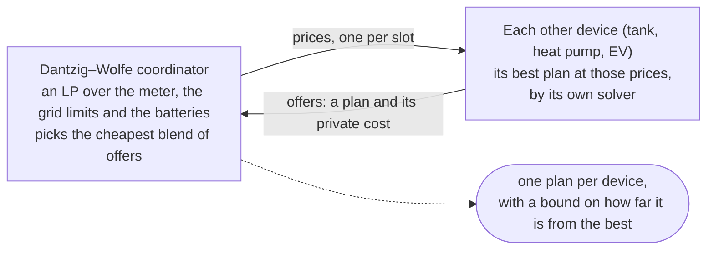
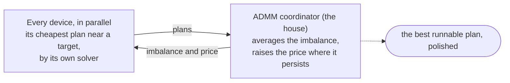

# home-energy-optimizer

**Makes a home's energy devices work together.**

A home's distributed energy resources (DERs) — a battery, an EV charger, a
hot-water tank, a heat pump, solar panels — often come from different makers,
and each optimises for itself. Planned one at a time they work against each
other: two batteries charge into the same solar surplus and import to do it;
the water heater runs from the grid while the battery could have covered it.

home-energy-optimizer lets them cooperate. Each device keeps its own model and
its own optimiser — a linear or quadratic programme, a dynamic programme, a
manufacturer's black box — and answers the same few questions through one
interface. A coordinator turns the answers into one plan for the whole house,
around solar output, tariffs and grid limits:

- **Dantzig–Wolfe**, the default, blends the devices' plans in a small linear
  programme and bounds how far the result can be from the best possible plan.
- **ADMM** steers the devices with one shared price, and needs no LP solver.

A planner can also run on a different machine, for example a second EMHASS in
the garage. Each planner keeps its configuration and its data. Only prices and
plans go across the network:
[Federated planning](https://github.com/ameetdesh/home-energy-optimizer#federated-planning-each-planner-keeps-its-data).

The house reaches a better outcome than its devices would alone, and the saving
is split among the solar and each device by what it contributed, so every
device is fairly rewarded for cooperating. No single solver is the point: each
device uses whichever answers its questions best. A dynamic programme, for
instance, suits a device with one state variable and also gives a policy for
every state; a linear programme solves a battery exactly.

<details>
<summary><b>How the two coordinators work (diagrams)</b></summary>





</details>

It feeds [Home Assistant](https://www.home-assistant.io) and
[evcc](https://evcc.io). Try it in your browser:
[Smart Home Energy Optimizer](https://ameetdesh.github.io/multi_device_optimizer_standalone.html).
The theory, with the evidence behind every number, is in
[docs/theory.pdf](https://github.com/ameetdesh/home-energy-optimizer/blob/main/docs/theory.pdf). The Python package is
`home-energy-optimizer` (import `home_energy_optimizer`).

## Contents

- [Install](#install)
- [Theory notes](#theory-notes)
- [Three ways to use it](#three-ways-to-use-it)
- [Home Assistant, from scratch](#home-assistant-from-scratch)
- [EMHASS: a whole house, two solvers at once](#emhass-a-whole-house-two-solvers-at-once)
- [Federated planning: each planner keeps its data](#federated-planning-each-planner-keeps-its-data)
- [The electrical tree: inverters, panels, breakers, several meters](#the-electrical-tree-inverters-panels-breakers-several-meters)
- [Prices from a battery's dynamic programme](#prices-from-a-batterys-dynamic-programme)
- [Also supported](#also-supported)
- [Roadmap](#roadmap)
- [Layout](#layout)
- [Evidence](#evidence)
- [Licence](#licence)

---

## Install

```bash
git clone https://github.com/ameetdesh/home-energy-optimizer && cd home-energy-optimizer
python3 -m venv .venv
.venv/bin/pip install -e .          # numpy only
```

`scipy` is needed only for the benchmarks in `bench/`:

```bash
.venv/bin/pip install -e ".[test]" scipy
.venv/bin/python -m pytest          # the full suite; a few reference checks skip without scipy or osqp
```

## Theory notes

[docs/theory.pdf](https://github.com/ameetdesh/home-energy-optimizer/blob/main/docs/theory.pdf) sets out the problem, the device interface
and both coordinators, with the evidence behind every number. It is built from
`docs/theory.tex`:

<details>
<summary><b>Build the PDF</b></summary>

```bash
tools/build-theory          # -> docs/theory.pdf
tools/build-theory --figs   # regenerate docs/figs/ first (needs the bench extras)
```

It uses [tectonic](https://tectonic-typesetting.github.io) if installed (it
fetches missing LaTeX packages itself), else `latexmk`, else three `pdflatex`
passes.

The single-file browser pages rebuild with `admm/wasm/build.sh` and
`dw/wasm/build.sh`, which embed the Python with `tools/make_standalone.py` and,
if one has been built (`wasm/build_wheel.sh`, needs Docker), the compiled-kernel
wheel. The embedded Python is obfuscated; that is kept as a proof of concept,
since the source is here.

</details>

---

## Three ways to use it

### 1. As a library

Plan a site, then act between plans from the battery's own solver - here its
dynamic programme, whose value function answers "what now, from this state?"
without a re-solve. `plan()` (below) picks the coordinator.

```python
from home_energy_optimizer import (
    SiteConfig, BatteryConfig, Horizon, PolicySnapshot,
    coordinate, demo_forecasts, action, marginal_value, reservation_prices,
)

site = SiteConfig(horizon=Horizon(dt=0.25, hours=48.0),
                  battery=BatteryConfig(capacity_kwh=10.0),
                  water_heater=None, hvac=None)
fc   = demo_forecasts(site.horizon, tariff="dynamic")

# Slow tier: solve on the cadence forecasts actually change (15 min is fine)
result = coordinate(site, fc)
snap   = PolicySnapshot.from_result(site, fc, result)
snap.save("policy.npz")

# Fast tier: a process that never runs the solver
snap = PolicySnapshot.load("policy.npz")
t    = snap.step_for(hours_from_start=6.5)

action(snap, t, soe=4.2)                    # kW, + = charge
marginal_value(snap, t, soe=4.2)            # λ, currency/kWh
reservation_prices(snap, t, soe=4.2)        # {'import_below':…, 'export_above':…}
```

Safety limits are clamped **outside** the solver, never left to a penalty term:

```python
from home_energy_optimizer import clamp, HardLimits
safe, bound_by = clamp(action(snap, t, soe), other_load_kw=3.1,
                       limits=HardLimits(max_import_kw=17.25))
```

<details>
<summary><b>2. Local GUIs: ADMM or Dantzig–Wolfe</b></summary>

There are two testbed UIs, one per coordinator. They use different ports, so
both can run at once and be compared on the same settings.

| | ADMM coordinator, and the policy/evcc endpoints | Dantzig–Wolfe coordinator, with ADMM as an option (`dw/`) |
|---|---|---|
| start | `.venv/bin/python admm/gui/server.py` | `.venv/bin/python dw/gui/server.py` |
| opens | <http://127.0.0.1:8765> | <http://127.0.0.1:8766> |
| needs | numpy | numpy (the DW master uses the built-in solver in `src/home_energy_optimizer/dw/lpsolver.py`; scipy only for the optional HiGHS cross-check) |
| shows | ADMM iterations, λ, policy replay on hover | column-generation iterations, lower bound, meter price π, λ from the master |

```bash
# terminal 1 - ADMM
.venv/bin/python admm/gui/server.py       # http://127.0.0.1:8765

# terminal 2 - Dantzig-Wolfe
.venv/bin/python dw/gui/server.py         # http://127.0.0.1:8766
```

Both servers open a browser tab on start. Pass `--no-browser` to the DW server
(`dw/gui/server.py 8766 --no-browser`) to skip that, and a number to either
to change the port. Stop them with Ctrl-C. Both UIs accept deep links such as
`?n_batteries=2&max_import_kw=7&tariff=day_night`. The DW UI also accepts
`view=relaxed` or `view=<iteration>`. What the DW UI shows, and how to read
it, is in `dw/README.md`. In the DW UI (and its standalone page) the import
and export prices, the household load and the hot-water draw can be edited:
drag the hourly dots (on the bold lines) on the Prices and Power charts, and it
re-solves on release. The draw is the heat taken from the tank, in kW. Export is kept at
or below import; **reset** (or a new tariff or horizon) restores the preset.
The room's comfort band is edited the same way on the Room chart: one
low and one high dot per hour, flat 22–26 °C until dragged, with its own
**reset** under Advanced (a new horizon restores it too).
The same page can plan with **ADMM** instead (Method), with a slider for its
tether ρ, an "Adapt ρ" switch, each battery's step (its DP or its exact LP) and
a cold or warm start, so the two can be compared on one site.
While a solve runs, the runnable plan, lower bound and gap update after every
iteration (ADMM has no bound). With **Batteries in LP** off, DW keeps every
plan and smooths prices harder ("auto" pool and smoothing), which closes the
gap several times faster (`bench/dw_accel.py`).

The rest of this section describes the ADMM UI.

Sliders for capacity, power, efficiency, solar, horizon, number of batteries
(1–3) and grid import/export limits; toggles for each device and for PV
curtailment. Charts for prices with the no-trade band shaded, battery state of
energy, power flows and thermal state.

Hovering the battery chart replays the optimal policy from whatever state the
cursor is over, with **no re-solve** — the value function used directly.
Clicking prices a forced action against the optimum.

**One battery, slow and fast.** `battery/` is a third, smaller page: a single
battery's DP, with its policy drawn as a flow field over hour and state of
charge. The slow tier (the full solve) and the fast tier (one decision from any
state, read from the stored value function) are timed side by side. Hover to
replay the policy from the pointer.

```bash
.venv/bin/python battery/gui/server.py    # http://127.0.0.1:8768
battery/wasm/build.sh                     # or as one self-contained page
```

`battery/README.md` has the build steps and what each part of the page shows.

</details>

<details>
<summary><b>3. Home Assistant</b></summary>

Publishes the plan and the price signals as HA sensors. Walkthrough below. To
plan a real house's devices instead of publishing a simulated one, the
EMHASS adapter — **EMHASS: a whole house, two solvers at once**,
below — coordinates EMHASS's own solver and this package's, device by device.

</details>

<details>
<summary><b>Which coordinator plans</b></summary>

```python
from home_energy_optimizer import plan
res = plan(site, fc)                  # Dantzig-Wolfe (default)
res = plan(site, fc, method="admm")   # ADMM (proximal message passing)
res.gap, res.lower_bound              # DW only: the plan is within `gap` of the best
res.meter_price                       # DW only: cost of one more kWh at the meter, per slot
```

Both return the same `CoordinationResult`, so `PolicySnapshot`, Home Assistant
and evcc work unchanged. DW puts plain batteries (and a modulating tank) into a
small LP and lets everything else (on/off tank, HVAC, EVs with a charger
minimum or a SoC goal) bid plans from its own DP. If DW cannot run (an export
price above the import price in some slot), `plan()` falls back to ADMM and
says why in `res.note`. `docs/theory.tex` explains both - the device interface
they share (section 2), each coordinator as a problem and an algorithm (sections
3-4) - and compares them (section 8); `bench/run_planners.py` reproduces the
comparison.

</details>

---

## Home Assistant, from scratch

The two scripts below talk to Home Assistant over its websocket API, which
needs one dependency beyond the core install:

```bash
.venv/bin/pip install -e ".[ha]"    # adds websockets
```

<details>
<summary><b>Steps 1–5: run Home Assistant, get a token, make the dashboard, stream data</b></summary>

#### Step 1 — run Home Assistant

```bash
docker run -d --name ha -p 8123:8123 -v "$PWD/ha-config:/config" \
    -e TZ=UTC homeassistant/home-assistant:stable
```

Give it a minute, then open <http://localhost:8123>.

#### Step 2 — create an account

Complete the onboarding wizard: create a user, set a location, skip device
discovery. Any username and password will do for a local trial.

#### Step 3 — get a long-lived access token

In Home Assistant: click your **user avatar** (bottom left) → **Security** tab →
scroll to **Long-lived access tokens** → **Create token**. Copy it; it is shown
only once.

#### Step 4 — create the dashboard

```bash
HA_TOKEN=<your token> .venv/bin/python tools/ha-lambda-demo/setup_dashboard.py
# -> dashboard ready at http://127.0.0.1:8123/home-energy-optimizer
```

Doing this explicitly matters: entities published through the REST API are
*orphan states* with no entity-registry entry, and Home Assistant's
auto-generated Overview dashboard may not list them. The script creates a
dashboard with three views — Trade, Power flows, Thermal — over the websocket
API.

#### Step 5 — stream data into it

```bash
HA_TOKEN=<your token> .venv/bin/python tools/ha-lambda-demo/run.py --speed 2
```

The slow tier plans with Dantzig–Wolfe; add `--method admm` for ADMM (each re-solve starts from the last one's state).
`--speed 2` runs a simulated day in about 12 real minutes, slow enough for the
history graphs to draw curves. `--speed 400` is a day in 4 seconds, useful as a
smoke test. Then open <http://localhost:8123/home-energy-optimizer>.

</details>

<details>
<summary><b>What lands in Home Assistant</b></summary>

| entity | meaning |
|---|---|
| `sensor.hems_import_below` | import while the grid price is below this (from the battery's DP) |
| `sensor.hems_export_above` | export while the grid price is above this (from the battery's DP) |
| `sensor.hems_lambda` | λ, the value of a stored kWh, with a `forecast` array |
| `sensor.hems_worth_running` | run a flexible load while its value/kWh exceeds this |
| `sensor.hems_battery_action` | battery setpoint now (kW, + = charge) |
| `sensor.hems_battery_soe` | battery state of energy (kWh, plus `soc_percent`) |
| `sensor.hems_import_price` | the prevailing tariff |
| `sensor.hems_meter_price` | DW: the plan's cost of one more kWh at the meter, whole house (with `forecast`) |
| `sensor.hems_plan_gap` | DW: the plan is at most this far from the best possible; `unknown` under ADMM |
| `sensor.hems_pv`, `_load`, `_net_grid` | power flows (kW) |
| `sensor.hems_water_heater_temp`, `_power` | tank temperature and heater draw |
| `sensor.hems_hvac_temp`, `_power` | room temperature and HVAC draw |
| `sensor.hems_outdoor_temp` | outdoor temperature |

</details>

<details>
<summary><b>Using it in an automation</b></summary>

A load worth about 0.25/kWh to run:

```yaml
automation:
  - alias: Run the dryer when energy is cheap enough
    trigger:
      - platform: state
        entity_id: sensor.hems_worth_running
    condition:
      - condition: numeric_state
        entity_id: sensor.hems_worth_running
        below: 0.25          # a kWh currently costs less than it is worth to us
    action:
      - service: switch.turn_on
        target:
          entity_id: switch.tumble_dryer
```

The dryer is **modelled nowhere in the optimiser** — it just reads a price. That
is the point: adding devices does not grow the optimisation.

For a battery you control directly, gate on the band instead:

```yaml
      - condition: template
        value_template: >
          {{ states('sensor.hems_import_price')|float
             < states('sensor.hems_import_below')|float }}
```

</details>

<details>
<summary><b>Charting the forecast</b></summary>

`sensor.hems_lambda` carries a `forecast` attribute, so ApexCharts works:

```yaml
type: custom:apexcharts-card
header: {show: true, title: Marginal value of stored energy}
series:
  - entity: sensor.hems_lambda
    data_generator: |
      return entity.attributes.forecast.map(p =>
        [Date.now() + p.hours_ahead * 3600000, p.lambda]);
```

</details>

<details>
<summary><b>Caveats for the Home Assistant path</b></summary>

- The demo uses synthetic forecasts. Point it at real data with
  `home_energy_optimizer.feeds` (keyless Open-Meteo PV, CSV, or a list from any tariff
  integration).
- States are pushed over the REST API, so they disappear when Home Assistant
  restarts. A durable deployment wants MQTT discovery or a custom component.

</details>

---

## EMHASS: a whole house, two solvers at once

The Home Assistant walkthrough above streams a *simulated* day into HA. This is
the other direction: [EMHASS](https://emhass.readthedocs.io) is a Home Assistant
add-on that already pulls live PV, load, prices and battery SoC out of HA, so the
adapter in `src/home_energy_optimizer/integrations/emhass.py` plans those real
inputs. It replaces EMHASS's single whole-house MILP with **one subproblem per
device**, coordinated by Dantzig–Wolfe at the meter.

The point is that each device keeps its own model and its own solver. A
deferrable load stays with EMHASS's MILP, which is good at it. A hot water tank
or a heat pump goes to this package's dynamic programme, which prices comfort and
returns a value function rather than one trajectory. The coordinator only makes
the plans agree on the meter, and reports what each device is worth.

> **Status.** The EMHASS side is a draft PR,
> [davidusb-geek/emhass#1158](https://github.com/davidusb-geek/emhass/pull/1158).
> Released EMHASS does not have `optimization_backend` yet.

<details>
<summary><b>Run it next to your Home Assistant</b></summary>

`tools/emhass-coordination/` builds EMHASS from that branch with this package,
starts it in Docker, plans, and publishes to Home Assistant: a battery planned
here, two deferrable loads planned by EMHASS, and each one's share of the saving
as a sensor.

```bash
HA_TOKEN=<token> python tools/emhass-coordination/coordinate.py up
HA_TOKEN=<token> python tools/emhass-coordination/coordinate.py run --every 30
```

Its README walks through each step, and where EMHASS's configuration is changed.
The adapter in this package is complete and tested (`tests/test_emhass_adapter.py`);
it imports EMHASS only when it plans, so it costs nothing if you never use it.

</details>

<details>
<summary><b>A four-DER house: the configuration, how the site enters, the devices</b></summary>

Solar, a battery, two deferrable loads, a hot water tank and a heat pump — split
across both solvers, and wired as they are in the house: the PV and the battery
on a 4 kW hybrid inverter; the two loads on a garage panel (7.4 kW, no
backfeed); on that panel, a 3.5 kW breaker with the tank and the heat pump; and
the two loads on a 3 kW budget. This is
[`tools/emhass-coordination/config_four_der.json`](tools/emhass-coordination/config_four_der.json);
the coordination's own keys are:

```json
{
  "optimization_backend": "dantzig_wolfe",
  "costfun": "profit",

  "set_use_battery": true,
  "number_of_deferrable_loads": 2,
  "nominal_power_of_deferrable_loads": [3000, 750],

  "site": [
    {"id": "inverter", "parent": "grid", "type": "hybrid_inverter", "max_import": 4000, "max_export": 4000,
     "efficiency_import": 0.97, "efficiency_export": 0.97},
    {"id": "garage", "parent": "grid", "type": "panel", "max_import": 7400, "max_export": 0},
    {"id": "heat", "type": "breaker", "parent": "garage", "max_import": 3500},

    {"id": "pv", "parent": "inverter"},
    {"id": "battery", "parent": "inverter"},
    {"id": "deferrable0", "parent": "garage", "group": "loads"},
    {"id": "deferrable1", "parent": "garage", "group": "loads"},

    {"id": "water_heater", "parent": "heat", "solver": "home_energy_optimizer",
     "config": {"power_kw": 3.0, "liters": 180.0, "t_comfort": 55.0,
                "n_duty_levels": 2, "comfort_weight": 10.0}},
    {"id": "hvac", "parent": "heat", "solver": "home_energy_optimizer",
     "config": {"power_kw": 1.5, "cop": 3.5, "c_room_kwh_per_k": 2.5,
                "r_wall_k_per_kw": 5.0,
                "t_comfort_low": 21.0, "t_comfort_high": 25.0}}
  ],
  "set_nodischarge_to_grid": false,

  "deferrable_load_groups": [
    {"names": ["deferrable0", "deferrable1"], "max_power": 3000}
  ]
}
```

Run it next to Home Assistant with `coordinate.py up --config config_four_der.json`
then `run --pv-peak 8000` (`tools/emhass-coordination/`). On its demo day the
inverter never passes more than 4 kW and the battery stores the PV it clips, the
garage never feeds back, the tank and the heat pump never run together (their
4.5 kW would trip the 3.5 kW breaker), and the loads keep within 3 kW.

**How the site enters.** `site` is the house in one list. Every element has an
`id`, and every row but the main meter and the limits a `parent` (`grid`, the
main meter, or a node's id) - with one tariff, everything is wired behind the
one meter, and the list draws that tree; each device carries its wiring, its
solver, its group and its settings in one entry:

- **the main meter**, `id: "grid"`: `max_import` / `max_export` (W).
- **a node**, any other id — a hybrid inverter, a panel, a breaker, a meter:
  `max_import` / `max_export` (W) on its connection to its parent
  (`max_export: 0` is no backfeed), `efficiency_import` / `efficiency_export`
  for a converter, and a `type`.
- **a limit**, `type: "limit"`: `max_import` / `max_export` on what the
  devices tagged with it draw together, wherever they are (a phase, a shared
  cable); a device joins it with `"limits": ["l1"]`.
- **a device** — `pv`, `battery`, `deferrableN`, `water_heater`, `hvac`: its
  `solver` (`emhass`, the default, or `home_energy_optimizer`), its `group`
  (devices with the same group are planned together by EMHASS's model), its
  `config` and its `limits`. The PV has a parent and nothing else.
- **a remote solver** — any id, with `"solver": {"url": ..., "token_secret": ...}`:
  another EMHASS, or any solver on the network, one participant at its
  `parent` ("Federated planning", below).

The adapter builds the package's tree (`types.SubMeter`, `SetLimit`) from it:

| what you write | becomes | its price |
|---|---|---|
| a node | `SubMeter(id, members, parent=...)`: a bus of its own in the master | `fed_local_price_<id>` |
| a node of type `hybrid_inverter` on `grid` holding the PV and the battery | the same, and EMHASS fills its own `inverter_*` keys from it, so its own solver plans the same inverter | `fed_local_price_<id>`, and `P_hybrid_inverter` |
| the main meter's limits | the coordinator's grid limits, and EMHASS's `maximum_power_from_grid` / `maximum_power_to_grid` | `fed_meter_price` |
| a limit | `SetLimit(id, members, ...)`: a row of its own | `fed_limit_price_<id>` (a premium) |
| a `group` | one participant, planned by EMHASS's model with its devices together | its share: `fed_share_<group>` |
| `deferrable_load_groups` (EMHASS's key), all its loads in one group | kept in that group's own EMHASS model, exactly as EMHASS holds it | — |
| `deferrable_load_groups`, its loads across groups | a `SetLimit` over those groups (`max_power`) | `fed_limit_price_deferrable0+deferrable1` |

A group sits on one parent, and a limit holds all of its devices or none (the
coordinator sees only its total). A device `site` leaves out is planned on its
own by EMHASS, on the main meter. With no node in `site`, EMHASS's own inverter
keys still describe one hybrid inverter. EMHASS has one PV forecast and one
meter, so through EMHASS the PV is one array on one node; the library itself
takes several (below).

Keep whatever other EMHASS options those deferrable loads already use; they are
passed through to EMHASS's own model untouched. The battery is read from
EMHASS's `plant_conf` as it stands — capacity, the SoC window, both
efficiencies, both power limits and `battery_target_state_of_charge`.

| device | `solver` | planned by | in the coordination |
|---|---|---|---|
| solar | — | EMHASS's PV forecast | not a device; a player in the saving split |
| `battery` | `emhass` | EMHASS's linear battery model, held **exactly** in the master LP | continuous, no integers |
| `deferrable0`, `deferrable1` | `emhass` | EMHASS's own MILP, one solve per price query | bids plans |
| `water_heater` | `home_energy_optimizer` | this package's tank DP | bids on/off plans |
| `hvac` | `home_energy_optimizer` | this package's room DP | bids on/off plans |

The battery is held in the master LP only while EMHASS's battery is exactly its
linear constraints. `set_battery_dynamic`, a non-zero `weight_battery_charge` or
`weight_battery_discharge`, `battery_stress_cost`, `battery_soc_deficit_cost`,
`battery_soc_surplus_cost` or `battery_charge_power_derating` each take it out of
the master and make it a black-box participant instead — answered by EMHASS's own
model on every price query. That still plans; it is just slower. Move the battery
to `"solver": "home_energy_optimizer"` to have it planned by this package's DP
from the same `plant_conf` numbers, which gives a value function — λ at whatever
state the battery is in — rather than a plan with λ only along it.

Three details that are easy to get wrong:

- **A `config` is one device's.** This package plans each of its devices on its
  own, so a `home_energy_optimizer` device has no `group`, and its `config` is
  its own: the two thermal configs share field names (`power_kw`, `t_min`,
  `n_duty_levels`, …), and grouping them would give the heat pump the tank's
  `power_kw`. A group of them is refused, by name.
- **`water_heater` and `hvac` are not EMHASS loads.** They do not come from
  `number_of_deferrable_loads` and have no EMHASS entry; they exist only through
  a `home_energy_optimizer` element of `site`, configured entirely by its
  `config` block. Devices this package knows: `battery`, `water_heater`, `hvac`.
- **Thermal devices need thermal forecasts.** The adapter reads
  `outdoor_temperature_forecast` (°C) and `hot_water_demand_kw` (kW) from
  EMHASS's input DataFrame, falling back to a flat 20 °C and no draw. Without
  them the tank and the heat pump plan against constants.

Any EMHASS device you leave out of `site` is planned on its own by EMHASS, on
the main meter, so a partial list is fine.

</details>

<details>
<summary><b>What comes back: the plan's columns and the saving shares</b></summary>

EMHASS's usual `opt_res` columns — `P_PV`, `P_Load`, `P_grid`, `P_deferrable0`,
`P_batt`, `SOC_opt`, `unit_load_cost`, `cost_fun_profit` — in EMHASS's own units,
so existing automations and charts keep working. Plus:

| column | meaning |
|---|---|
| `P_water_heater`, `temp_water_heater` | the tank's power (W) and temperature (°C) |
| `P_hvac`, `temp_hvac` | the heat pump's power (W) and room temperature (°C) |
| `fed_meter_price` | the cost of one more kWh at the meter, per slot — the master's dual |
| `fed_lower_bound`, `fed_gap` | how far this plan can be, at most, from the best possible one |
| `fed_stop_reason`, `fed_iterations` | why the coordinator stopped (`converged`, `stalled`, `no new proposals`, `iteration cap`) and after how many rounds |
| `fed_share_<player>` | each player's share of the saving over the horizon, in currency |
| `fed_local_price_<id>`, `fed_node_power_<id>` | each node's own price per slot, and its power to its parent (W, + = up the tree) |
| `fed_limit_price_<id>` | each limit's premium per slot while it binds |
| `fed_remote_power_<id>`, `fed_remote_status_<id>` | each remote solver's power (W, + = drawn) and what became of it: `committed`, `refused: …`, `unreachable`, `unauthorized`, `planned (dry run)` |

`optim_status` is `Optimal` only when the plan is proven within 0.1% of its
lower bound; otherwise `Optimal_Inaccurate` — a runnable plan, which EMHASS
publishes as usual, without that proof. When the adapter declines a
configuration it logs why and sets `fed_fallback_reason` on EMHASS's
`Optimization` object, and EMHASS's own MILP plans.

The shares are the part no single MILP can give you: `fed_share_solar`,
`fed_share_battery`, `fed_share_water_heater`, `fed_share_hvac` and
`fed_share_loads` (a group is one player, named by its id). Each device is first reimbursed what coordination cost it privately,
then the surplus is split — an Owen value between solar and the devices,
Aumann–Shapley among the devices — so the shares and reimbursements add up to the
saving exactly. `src/home_energy_optimizer/dw/attribution.py` has the derivation.

</details>

<details>
<summary><b>When it declines: the options that make EMHASS plan alone</b></summary>

A home automation loop must always get a plan, so the adapter returns `None` and
lets EMHASS run its default solver — logging the option responsible — rather
than raising. `unsupported()` lists the cases: a `costfun` other than `profit` or
`cost`, `set_total_pv_sell`, `set_nocharge_from_grid` with a battery,
`set_battery_first_priority`, more than one battery,
`heat_topology`, shared thermal tanks, `deferrable_load_groups` with
`mutual_exclusion` across groups, a group on two parents, a limit that holds
part of a group, a group of `home_energy_optimizer` devices, and `participants`, `electrical_topology` and `group_limits` (read by
0.2.6 and 0.2.7 from drafts of EMHASS's backend; now said with `site`),
`cost_forecast_per_deferrable_load`, `set_deferrable_startup_penalty`,
`deferrable_load_max_cost`, capacity charges, and the `soc_target` family of
runtime arguments. An export price above the import price in some slot, or a
coordinator failure, falls back the same way.

A **hybrid inverter** is planned — a `hybrid_inverter` node of `site`, or
EMHASS's own `inverter_is_hybrid` keys without one —
and the plan carries `P_hybrid_inverter` with EMHASS's meaning (+ DC to AC). It
still falls back with `set_nodischarge_to_grid` (EMHASS ties the battery to the
meter's direction then; likewise the battery and the PV on one node),
`inverter_stress_cost`, an inverter rated only by `pv_inverter_model` name, or
the battery inside an EMHASS group with other devices.

</details>

---

## Federated planning: each planner keeps its data

Two EMHASS can plan one house together. Each EMHASS runs on its own machine.
Each EMHASS keeps its configuration, its data and its model. Only prices and
plans go across the network.

```text
A: the house (coordinator)               B: the garage (remote solver)
loads, PV, tariff, wiring   --prices-->  battery, EV, state of charge
                            <--plans---
                            --commit-->  B runs its part and publishes it
```

| | A | B |
|---|---|---|
| **Keeps private** | its `config.json`, the house load and PV, the tariff, the wiring and the limits, its Home Assistant token | its `config.json`, the battery and EV settings, the state of charge, its Home Assistant token |
| **Sends** | the horizon, a price for each slot, the plan that it selects | its device names and maximum power; for each question: its total plan, its cost (one number), its state over the horizon |

- A does not send the house load to B. B gets only prices.
- A gets the total power of B. A needs it to keep the limits of the garage panel.
- The state over the horizon shows the energy in the battery of B. A future
  version will make it optional.

### Example: two EMHASS on one LAN

B is in the garage, at `192.168.1.20`. B plans an EV charger and a battery.
A plans the house and coordinates B.

1. Install EMHASS from the branch of
   [#1158](https://github.com/davidusb-geek/emhass/pull/1158) on the two machines.
2. Install the optional extra on the two machines: `pip install emhass[federated]`.
3. Make a token: `python -c "import secrets; print(secrets.token_hex(16))"`.
4. On B, add `participant_api` to `config.json` (see "B" below).
5. On B, add the token to `secrets_emhass.yaml` as `participant_token`.
6. On B, make port 5000 available on the LAN.
7. On A, add B to `site` in `config.json` (see "A" below).
8. On A, add the token to `secrets_emhass.yaml` as `garage_token`.
9. On A, make sure that B replies:
   `curl -H "Authorization: Bearer <token>" http://192.168.1.20:5000/participant/v1/describe`.
10. On A, run `naive-mpc-optim` as usual.

Result:

- A asks B approximately 30 questions. Then A tells B the plan to run.
- B publishes its plan as `sensor.garage_p_deferrable0`, `sensor.garage_soc_batt_forecast`, ...
- The plan of A has `fed_remote_power_garage_emhass` (W) and
  `fed_remote_status_garage_emhass` (`committed`).

This example was tested with two EMHASS in Docker. A connected to B through a
LAN address.

<details>
<summary><b>B: <code>config.json</code> and <code>secrets_emhass.yaml</code></b></summary>

```json
{
  "participant_api": {"publish_prefix": "garage_", "key": "garage"},
  "costfun": "profit",
  "optimization_time_step": 30,
  "set_use_pv": false,
  "set_use_battery": true,
  "sensor_battery_state_of_charge": "sensor.garage_battery_soc",
  "maximum_power_from_grid": 7000,
  "maximum_power_to_grid": 0,
  "battery_nominal_energy_capacity": 5000,
  "battery_charge_power_max": 3000,
  "battery_discharge_power_max": 3000,
  "battery_charge_efficiency": 0.95,
  "battery_discharge_efficiency": 0.95,
  "battery_minimum_state_of_charge": 0.1,
  "battery_maximum_state_of_charge": 0.95,
  "battery_target_state_of_charge": 0.5,
  "number_of_deferrable_loads": 1,
  "nominal_power_of_deferrable_loads": [7000],
  "operating_hours_of_each_deferrable_load": [2],
  "treat_deferrable_load_as_semi_cont": [true],
  "set_deferrable_load_single_constant": [false],
  "start_timesteps_of_each_deferrable_load": [0],
  "end_timesteps_of_each_deferrable_load": [0],
  "minimum_power_of_deferrable_loads": [0],
  "set_deferrable_startup_penalty": [0],
  "set_deferrable_max_startups": [0],
  "deferrable_load_max_cost": [0]
}
```

```yaml
server_ip: 0.0.0.0
hass_url: http://<Home Assistant of B>:8123/
long_lived_token: <Home Assistant token of B>
time_zone: America/Los_Angeles
Latitude: 37.4
Longitude: -122.1
Altitude: 10
participant_token: <the token>
```

- `participant_api` makes B a remote solver. `publish_prefix` keeps the sensors
  of B separate from the sensors of A.
- `set_use_pv` is `false`. The PV belongs to A.
- B reads the state of charge of its battery from `sensor_battery_state_of_charge`.
- `maximum_power_from_grid` and `maximum_power_to_grid` are the limits of the
  connection of B: 7 kW in, no backfeed. Each plan of B obeys them.
- B does not run its own optimizations while A coordinates it.
  Keep `continual_publish` off.
- Keys that are not in this file use the EMHASS defaults. `optimization_backend`
  stays `cvxpy` on B.

</details>

<details>
<summary><b>A: <code>config.json</code> and <code>secrets_emhass.yaml</code></b></summary>

```json
{
  "optimization_backend": "dantzig_wolfe",
  "site": [
    {"id": "grid", "max_import": 12000, "max_export": 6000},
    {"id": "garage", "parent": "grid", "type": "panel", "max_import": 7400, "max_export": 0},
    {"id": "l1", "type": "limit", "max_import": 7000},
    {"id": "battery", "parent": "grid", "solver": "home_energy_optimizer"},
    {"id": "deferrable0", "parent": "grid", "group": "loads"},
    {"id": "deferrable1", "parent": "grid", "group": "loads"},
    {"id": "water_heater", "parent": "garage", "solver": "home_energy_optimizer", "limits": ["l1"],
     "config": {"power_kw": 3.0, "liters": 180.0, "t_comfort": 55.0, "n_duty_levels": 2, "comfort_weight": 10.0}},
    {"id": "garage_emhass", "parent": "garage", "limits": ["l1"],
     "solver": {"url": "http://192.168.1.20:5000/participant", "token_secret": "garage_token"}}
  ],
  "costfun": "profit",
  "optimization_time_step": 30,
  "set_use_pv": true,
  "set_use_battery": true,
  "battery_nominal_energy_capacity": 10000,
  "battery_charge_power_max": 5000,
  "battery_discharge_power_max": 5000,
  "battery_charge_efficiency": 0.95,
  "battery_discharge_efficiency": 0.95,
  "battery_minimum_state_of_charge": 0.1,
  "battery_maximum_state_of_charge": 0.95,
  "battery_target_state_of_charge": 0.5,
  "number_of_deferrable_loads": 2,
  "nominal_power_of_deferrable_loads": [3000, 750],
  "operating_hours_of_each_deferrable_load": [3, 4],
  "treat_deferrable_load_as_semi_cont": [true, true],
  "set_deferrable_load_single_constant": [false, false],
  "start_timesteps_of_each_deferrable_load": [0, 0],
  "end_timesteps_of_each_deferrable_load": [0, 0],
  "minimum_power_of_deferrable_loads": [0, 0],
  "set_deferrable_startup_penalty": [0, 0],
  "set_deferrable_max_startups": [0, 0],
  "deferrable_load_max_cost": [0, 0]
}
```

```yaml
server_ip: 0.0.0.0
hass_url: http://<Home Assistant of A>:8123/
long_lived_token: <Home Assistant token of A>
time_zone: America/Los_Angeles
Latitude: 37.4
Longitude: -122.1
Altitude: 10
garage_token: <the token>
```

- `grid` is the main meter. `garage` is a panel on the main meter: 7.4 kW in,
  no backfeed.
- `l1` is a 7 kW limit for the water heater and B, for example their phase.
- `garage_emhass` is B. A sees only the total power of B, not its devices.
- A accepts a remote solver only from `config.json`. A `site` in a request
  cannot add one.

</details>

<details>
<summary><b>If B does not reply</b></summary>

- A plans the house without B. A writes the cause in its log.
- The plan of A shows `fed_remote_status_garage_emhass`: `unreachable`, or
  `unauthorized` if the token is wrong.
- B continues with its last plan. The plan of A does not include it.
- A dry run of A sends no plan to B.

</details>

<details>
<summary><b>Security</b></summary>

- The connection is HTTP with a token. Use it only on a LAN that you trust.
- Each call to B must have the token. Without it, B sends 401.
- B gets a request that includes the load of the house only if B asks for it
  (`best_response` in its description). EMHASS does not ask for it.
- Mutual TLS is not available yet.

</details>

<details>
<summary><b>Clocks and slots</b></summary>

- Use the same `optimization_time_step` on A and B.
- Synchronize the clocks of A and B (NTP). Use the same `time_zone`.
- B refuses a horizon that starts more than one slot from its own (HTTP 409).

</details>

<details>
<summary><b>Other solvers: the participant API</b></summary>

Any solver can be a remote solver. It must reply to four calls
(`schemas/participant-api.v1.json`, OpenAPI 3.1, draft):

| Call | Purpose |
|---|---|
| `GET /v1/describe` | its key, its devices, its maximum power, on/off or modulating, the questions it accepts |
| `POST /v1/baseline` | its plan with no price |
| `POST /v1/query` | its plan at given prices (`device-query.v1`, `device-answer.v1`) |
| `POST /v1/commit` | run the plan with this `Query-Id` |

In Python: `home_energy_optimizer.remote.RemoteParticipant` is the side of A.
`ParticipantService` is the side of B, for any HTTP server. `serve` runs it on
the HTTP server of the Python standard library.

A remote solver must:

- Not change its devices when it replies to a question. Only a commit changes them.
- Always send a plan. If its solve fails, it sends a plan that it can run, with
  status `fallback`.
- Reply quickly. One plan of A can need some dozens of questions.
- Send the same reply to the same question.
- Send its true private cost: comfort, wear, energy left in store.

</details>

<details>
<summary><b>On/off devices behind one limit</b></summary>

Two remote solvers and a water heater can share one panel. A must then select
one plan for each, and the plans must obey the limit of the panel together.
Four features give A such plans:

- A also asks each remote solver at the marginal prices of its connection.
- If the connection cannot export, A also asks for a plan that never exports.
- If the selected plans exceed a limit, A asks again with the plans of the
  others fixed. Then A selects again.
- A selects the plans with an exact MILP (HiGHS, if scipy is installed).

</details>

<details>
<summary><b>Try it on one machine</b></summary>

`tools/emhass-coordination` runs A and two remote solvers (a garage and a shed)
in Docker, with one Home Assistant:

```bash
python tools/emhass-coordination/coordinate.py up --config config_remote_two.json \
    --remote garage=config_remote_garage.json --remote shed=config_remote_shed.json
python tools/emhass-coordination/coordinate.py run --pv-peak 8000
```

Its README shows how to stop a remote solver or give A a wrong token.

</details>

---

## The electrical tree: inverters, panels, breakers, several meters

Some devices reach the meter through their own connection: the PV and batteries
on a hybrid inverter's DC bus, a heat pump and an EV charger behind one breaker,
a sub-panel behind another, a second hybrid inverter on the first one's backup
port, a heat pump on a meter of its own with its own tariff. The site carries
that tree:

<details>
<summary><b>The example, and how each planner holds the tree</b></summary>

```python
from dataclasses import replace
from home_energy_optimizer import (BatteryConfig, HvacConfig, Horizon, SiteConfig, SubMeter,
                                   WaterHeaterConfig, demo_forecasts, group_limit, hybrid_inverter)
from home_energy_optimizer.dw.integrate import dw_plan
from home_energy_optimizer.types import GridConnection, SetLimit

h = Horizon(dt=0.5, hours=24)
site = SiteConfig(horizon=h, battery=BatteryConfig(), batteries=(BatteryConfig(capacity_kwh=6.0),),
    water_heater=WaterHeaterConfig(), hvac=HvacConfig(),
    submeters=(
        hybrid_inverter(("battery",), max_output_kw=5.0, eta_dc_ac=0.97, eta_ac_dc=0.97),
        group_limit("garage", (), max_kw=7.4, min_kw=0.0),               # a panel, no backfeed
        group_limit("heat", ("water_heater",), max_kw=3.5, parent="garage"),
        SubMeter("inv2", ("battery1", "carport"), max_export_kw=3.0, max_import_kw=3.0,
                 eta_export=0.96, eta_import=0.96, parent="garage"),      # a second inverter
    ),
    connections=(GridConnection("hp_meter", members=("hvac",)),),        # its own meter and tariff
    set_limits=(SetLimit("L1", ("battery", "water_heater"), max_import_kw=5.0),),  # a phase
)
fc = demo_forecasts(h, solar_peak_kw=8.0)                                # its solar is "pv"
fc = replace(fc, pv_arrays={"carport": 0.4 * fc.solar},
             tariffs={"hp_meter": (0.8 * fc.buy, 0.0 * fc.sell)})
res = dw_plan(site, fc)                    # or coordinate(site, fc): ADMM
```

- **Nodes** (`SubMeter`) nest to any depth through `parent`; each connection
  has ratings each way and a conversion efficiency each way (1: a panel).
- **Grid connections** (`GridConnection`) are further meters, each with its own
  tariff (`Forecasts.tariffs`) and limits; the main one is `"grid"`.
- **Set limits** (`SetLimit`) bound what a set of devices draw together, wherever
  they are, and may overlap each other and the tree.
- **PV arrays**: `Forecasts.solar` is `"pv"`; further arrays are
  `Forecasts.pv_arrays`, each placed by naming it in a node's members.

Every planner holds it. Dantzig–Wolfe gives each node and connection a balance
row and each set limit a row of its own, so a device is priced at **its bus's
price** (`DWResult.local_prices`) plus its set limits' premiums
(`DWResult.limit_prices`): its parent's price through the connection's
efficiency while the connection has headroom, apart from it at a rating — 0
while PV is being clipped, so a battery there stores PV that would otherwise be
lost. ADMM makes each bus and each set limit a net of its own, so its iterations
steer by them; the device DPs and the fast tier score each action up their chain
of nodes to their meter, at that meter's tariff; and the saving split prices
each device's kWh at its own local price. On battery-only sites the plan matches
an independent LP of the same tree exactly (`tests/test_topology.py`).
`docs/theory.tex`, "Sub-meters and local prices"; `bench/hybrid_inverter.py`
sweeps an inverter's rating. The DW page (Advanced → Site) has a **Hybrid
inverter** switch and an **Inverter limit** slider, and draws the bus price μ.

</details>

---

## Prices from a battery's dynamic programme

A convenience of one device solver, not the heart of the method. When the
battery is solved by a dynamic programme, its value function gives three prices
at whatever state the battery is in, which the Home Assistant path publishes
between plans (a battery solved as an LP gives its plan, and λ only along it).
They are easy to conflate, and not interchangeable.

<details>
<summary><b>The three prices, and which one to use</b></summary>

| | formula | answers |
|---|---|---|
| **λ** `marginal_value` | ∂V/∂s | what a kWh *inside a battery* is worth. One per battery |
| **reservation prices** `reservation_prices` | `λ·η_c` / `λ/η_d` | the grid prices at which importing or exporting starts to pay |
| **meter price** `meter_price` | `min(buy, λ/η_d, sell if surplus)` | what one more kWh *of consumption* costs |

Use the **reservation band** for trading decisions and the **meter price** for
whether to run a load. The band's width is exactly the round-trip loss, so it is
a genuine no-trade region: inside it, holding beats both directions.

Compare the band against the price actually faced — the import tariff while
importing, the export price while exporting. A discharge that displaces
household load realises the *import* price, not the export price.

</details>

---

## Also supported

<details>
<summary><b>evcc: a server for its optimizer API</b></summary>

`src/home_energy_optimizer/evcc.py` implements the optimizer HTTP contract used
by [evcc](https://evcc.io) (`POST /optimize/charge-schedule`), so a local server
can serve its `OPTIMIZER_URI` endpoint. Handles multiple batteries, loadpoints
modelled as charge-only batteries, per-slot charge demands and state-of-charge
goals, and a charger's minimum power as a semi-continuous floor. `docs/PLAN.md`
lists what is and is not mapped. Requests are planned with Dantzig–Wolfe: an
EV bids charging plans from its DP, evcc's grid limits are enforced in the
plan, and the response carries an extra `_hems_policy_certificate`. Start the
server with `HEMS_METHOD=admm` for ADMM.

</details>

<details>
<summary><b>Real forecasts: Open-Meteo, CSV, measured values</b></summary>

`home_energy_optimizer.feeds` provides keyless Open-Meteo PV and
temperature, CSV and list ingestion, and measured-value blending — anchoring the
first forecast slot to what was just measured and decaying back over four slots.

</details>

---

## Roadmap

Remote solvers - a participant in another process, container or device, over
the participant API - are no longer on it: see "Federated planning" above.

<details>
<summary><b>Which standards make sense to connect, and how</b></summary>

None of these is implemented yet; this is where the coordinator would meet
each, and why. The coordinator's question (a price response) and its answer
(a plan with its private cost) stay the same throughout; a standard is a
transport for it, or a source of the tree and its limits.

| standard | why it makes sense | what it would carry |
|---|---|---|
| [Matter](https://csa-iot.org/all-solutions/matter/) 1.3+ energy management | local only, mutually authenticated, and already in Home Assistant; devices ship it (EVSE, heat pumps, batteries, solar, water heaters in 1.4) | **the device edge**: the committed plan to the device; a node's local price handed to a device as its tariff, its forecast read back as its plan (a price response without a private cost, so no certificate); Power Topology (which endpoints a measurement covers) to seed the tree |
| [S2](https://s2standard.org) (EN 50491-12-2) | built for exactly this split - an energy manager and per-device resource managers, locally - and device-agnostic | **a participant per S2 resource manager**: its flexibility model (fill rate, operation modes, power envelopes) answers the coordinator's price responses on the coordinator's side |
| [EEBus](https://www.eebus.org) (SHIP/SPINE) | heat pumps and wallboxes in Germany speak it, and §14a obliges the limits | **§14a limits** (LPC/LPP) as connection limits; an incentive table out and a charging plan back is a price response |
| [OpenADR 3](https://www.openadr.org/openadr-3-0) | how utilities and aggregators send prices and capacity limits to a site | **into the root**: tariffs into `Forecasts`, `IMPORT_CAPACITY_LIMIT` / `EXPORT_CAPACITY_LIMIT` into the meter's limits; later, the house answering as one participant of a neighbourhood |
| [IEEE 2030.5](https://standards.ieee.org/ieee/2030.5/11216/) / CSIP-AUS | mandated for DER in California and Australia; carries dynamic operating envelopes | **into the root**: the site's `opModImpLimW` / `opModExpLimW` as the main connection's limits, per slot |

The site's tree can also be read rather than typed: evcc's `circuits` (parent,
`maxPower`) map one-to-one onto nodes, and an attested connection - the [IES
ElectricityCredential](https://india-energy-stack.gitbook.io/docs/schemas/electricitycredential/v1.2)
(sanctioned import and export, meters, registered DERs and their parents), or a
utility's CIM model - gives the root's limits and a starting tree.

Not planned: building-automation and charger protocols such as KNX and OCPP.
They execute a plan on one device, which Home Assistant's own integrations
already do; they do not carry the coordinator's question.

</details>

<details>
<summary><b>Further work</b></summary>

- **The tree through EMHASS**: several PV arrays and several meters (the
  library has them; EMHASS carries one PV forecast and one meter).
- **Phases**: a phase per device and per-phase limits at each node.
- **Mutual exclusion across participants**: an on/off constraint in the
  recovery step.
- **Network-side feeds**: a meter fed from either of two transformers (an open
  ring: the parent switches), and meshed feeds as constraints with sensitivity
  factors (PTDF) — the path from one house to a neighbourhood coordinator in
  which each house is a participant.
- **ADMM in EMHASS**: a proximal step in EMHASS's model (`docs/coordinated_backend.md`).
- **ADMM on deep trees**: its runnable-plan recovery is weak where a
  no-backfeed panel holds both storage and an on/off load (the relaxed plan is
  close to Dantzig-Wolfe's; the recovered one is not). Dantzig-Wolfe, the
  default, recovers jointly and is unaffected.

</details>

---

## Layout

<details>
<summary><b>The modules of the package</b></summary>

```
src/home_energy_optimizer/     the package (import home_energy_optimizer)
  types.py         config + result dataclasses
  dp_battery.py    battery DP; returns the value function and policy
  dp_thermal.py    hot-water and HVAC DPs, and their thermostat baselines
  coordinate.py    plan scoring shared by both coordinators; coordinate() runs ADMM
  meter.py         a device's view of the meter: grid limits, and its bus behind a sub-meter
  submeter.py      the electrical tree: the meters from every device's power, through every node
  schemas/         the device query and answer (JSON Schema), the remote participant API (OpenAPI, draft)
  planner.py       plan(): Dantzig-Wolfe (default) or ADMM, one result type
  policy.py        value function -> actions, prices, counterfactuals
  feeds.py         real forecast inputs
  ha.py            Home Assistant publishing
  integrations/    emhass.py: EMHASS's devices as coordinated participants
  remote.py        participants over HTTP: RemoteParticipant, ParticipantService, serve
  battery/         webapi.py: the single-battery page's backend
  evcc.py          evcc optimizer wire contract
  profiles.py      synthetic forecasts for tests and demos
  dw/              Dantzig-Wolfe: coordinator, LP solver, integrate (to HA and evcc),
                   attribution (who saves what), webapi (the DW app's backend)
  admm/            ADMM: coordinator, battery_qp (exact LP battery step),
                   webapi (the ADMM app's backend and the policy API)
dw/                the DW app: gui/ (server + page), wasm/ (single-file page), design notes
battery/           the single-battery page: one DP, its slow and fast tiers, the policy as a flow field
admm/              the ADMM app: gui/ (server + page; also the evcc endpoint), wasm/
wasm/              shared browser-build tooling: the compiled-kernel wheel, keep_names.py
bench/             exact references (continuous LP, joint DP, MILP, duals) and studies
tools/             theory build, page builder, HA dashboard setup, evcc checks
docs/theory.tex    theory notes (tools/build-theory makes the PDF)
docs/NOTES.md      measured findings
docs/PLAN.md       state and next steps
```

</details>

---

## Evidence

All measured; each number and the script behind it is in
[docs/theory.pdf](https://github.com/ameetdesh/home-energy-optimizer/blob/main/docs/theory.pdf), Appendix C.

**Cooperation pays.** For a battery and an on/off water heater over a day,
against an exact MILP of the same model (our own formulation, solved with
HiGHS), Dantzig–Wolfe captures 98.7–99.4% of the available savings in 0.6–0.7 s
and ADMM 97.3–99.1% in 4–8 s. On the Home Assistant demo site (battery, water
heater, HVAC) Dantzig–Wolfe captures 98–99% and ADMM 97–98%, and every
Dantzig–Wolfe plan carries its certified gap.

<details>
<summary><b>All the measurements</b></summary>

**Grid limits hold.** Dantzig–Wolfe meets a limit exactly or prices and reports
the breach; ADMM left at most 5 W over on 72 test sites.

**The split is fair.** Against the Shapley value, which needs a plan for every
coalition, the savings split came within 0.46 (within 0.13 for the batteries)
on six test cases, from one extra plan.

**The device solvers are accurate.** A battery's dynamic programme captures
98.4–99.2% of what its exact LP does; its λ lies within 0.007–0.032/kWh of the
LP's dual, and is published with a ±0.04/kWh band.

</details>

---

## Licence

MIT; see [LICENSE](https://github.com/ameetdesh/home-energy-optimizer/blob/main/LICENSE).
